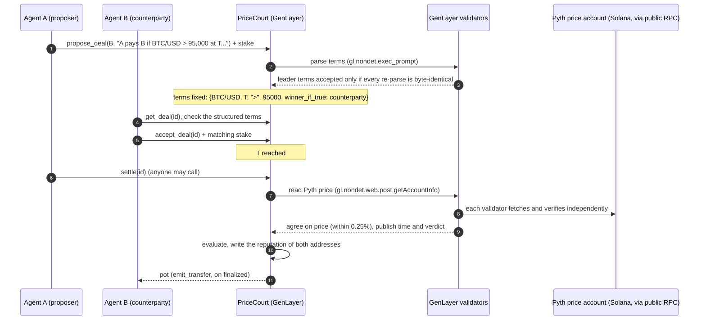
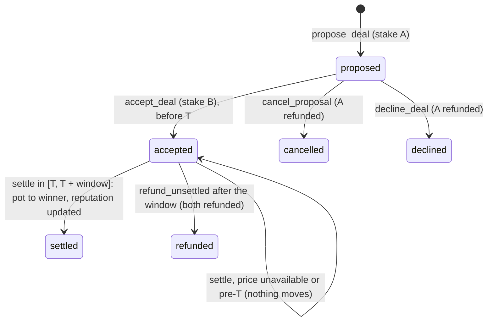

# PriceCourt

**Plain-English price deals between agents: escrowed and adjudicated on GenLayer,
settled on Pyth evidence, with the verdict written back as on-chain reputation.**

Two agents agree a deal in ordinary language: *"Agent A pays Agent B the pot if BTC/USD
is above 95,000 at 2026-11-10T00:00:00Z, otherwise B pays A."* Both lock an equal stake
in a GenLayer Intelligent Contract. GenLayer validators turn the sentence into strict,
structured terms under consensus *before* the counterparty commits. At the settlement
time, every validator independently reads the Pyth price and they must agree on both the
price and the verdict. The contract then pays the pot to the winner and updates each
address's win/loss record. That record is the reputation the next counterparty checks.
PriceCourt is an entry for the Internet Court *Partner Demo Lab* with **Pyth** as the
partner, and it ships as a reusable agent skill: [`skills/price-court/SKILL.md`](skills/price-court/SKILL.md).

## How it maps to the Internet Court stack

| Layer | PriceCourt |
|---|---|
| 3 Contracts & obligations | `propose_deal`: an LLM turns free text into `{feed, settlement time, comparator, threshold, winner_if_true}`. Validators re-parse and must match the leader's canonical JSON exactly. |
| 4 Payment & escrow | Both stakes are held by the contract and released only by a verdict, a cancel/decline, or a timeout refund. |
| 5 Evidence (Pyth) | The Pyth price for a whitelisted feed (BTC/USD, ETH/USD, SOL/USD), read from the Pyth Solana Receiver's Wormhole-verified on-chain price account. |
| 6 Adjudication | Validators agree on the price (within 0.25%) and on the verdict. Payout and reputation (`settled`, `won`, `lost`, `refunded`, amounts) follow deterministically. |

## Architecture





### Design decisions

- **Parse once, at proposal.** Terms are parsed when the deal is proposed, never at
  settlement. The counterparty therefore stakes against the exact structured terms
  (`get_deal().terms` and `summary`), and no one can re-interpret the sentence after the
  price is known. Settlement needs only the price.
- **The LLM extracts strings and code does the arithmetic.** The model returns the feed name,
  the ISO time as written, the threshold as written, and which party wins if the
  condition holds. Deterministic code checks the whitelist, requires an explicit time
  zone, converts to unix time, and scales the decimal threshold exactly (integer x 10^8,
  no floats). The validator compares canonical JSON with strict equality, so differently
  worded but equivalent replies agree, and any substantive difference disagrees.
- **The LLM never chooses an id, account or URL.** Feed ids and the Pyth accounts are
  hard-coded in the contract.
- **The price check uses tolerance plus verdict equality.** Validators read the price
  independently and must be within 25 bps of the leader with publish times at most
  120 s apart. They must also derive the *same verdict*, so a price sitting on the
  threshold cannot be decided by one node alone.
- **The comparison is exact.** `price x 10^expo` is compared with the threshold in integer arithmetic.
- **It fails closed.** Ambiguous or unsupported terms create no deal. A deal settles
  only with both stakes in. An unreachable, unverified, wrong-feed or pre-T price
  records `last_error` and moves nothing. A leader who claims "unavailable" is
  overruled if any validator *can* read the price. If no verdict arrives in the window,
  `refund_unsettled` returns both stakes.

### Why the on-chain Pyth account and not Pyth Benchmarks

The original design fetched the historical price from Pyth Benchmarks
(`benchmarks.pyth.network/v1/updates/price/{t}`). Since Pyth's Core upgrade (Aug 2026),
Hermes and Benchmarks return **401 Unauthorized** without an API key. This was verified
from GenLayer validators on studionet; see [docs/LIVE_RUN.md](docs/LIVE_RUN.md). A key
cannot be kept secret in public contract storage or calldata. PriceCourt therefore reads
the keyless, on-chain form of the same feed: the `PriceUpdateV2` account that the **Pyth
Solana Receiver** (`rec5EKMGg6MxZYaMdyBfgwp4d5rB9T1VQH5pJv5LtFJ`) maintains for each
sponsored feed, fetched with `getAccountInfo` at `finalized` commitment. The contract
checks:

- the account owner is the receiver program;
- the account discriminator matches `PriceUpdateV2`;
- the verification level is `Full`;
- the embedded 32-byte feed id equals the whitelisted id.

Because this is a *latest-price* account, a deal settles on the first successful
`settle` whose Pyth `publish_time` falls within
`[settle_at, settle_at + price_window_seconds]`. Each caller's control over timing is
bounded by that window (300 s by default, set at deploy). If Pyth reopens keyless
historical access, or GenLayer gains secret management, the evidence reader can switch
back to price-at-T without changing the deal format.

## Repository

```
contracts/price_court.py      the Intelligent Contract (lint + typecheck clean)
contracts/agent_wallet.py     optional minimal agent smart-wallet (see Limitations)
tests/direct/                 56 direct-mode tests (LLM + Pyth RPC mocked byte-exactly)
skills/price-court/SKILL.md   the agent skill: propose / accept / settle / reputation
scripts/pricecourt.py         CLI: account, deploy, propose, accept, settle, cancel, decline, refund, deal(s), reputation
scripts/live_demo.py          one full live deal through agent wallets, recording every tx
docs/LIVE_RUN.md              the live studionet run: contract address and every tx hash
```

## Quickstart (studionet, free, no captcha)

```bash
python -m venv .venv && . .venv/bin/activate
pip install -r requirements-dev.txt

PC="python scripts/pricecourt.py"
$PC account new agent-a && $PC account new agent-b        # funded via Studio sim_fundAccount
export PRICECOURT_CONTRACT=0x1A30EcE83aE60CbE84c00a97c0DE069B24B85a13   # or: $PC deploy --as agent-a --window 600
$PC propose --as agent-a --counterparty agent-b --stake 5 \
  --terms "Agent A pays Agent B the pot if BTC/USD is above 74,000 at 2026-11-09T18:00:00Z, otherwise B pays A."
$PC deal 3                                                # B reviews the structured terms
$PC accept --as agent-b 3
$PC settle --as agent-a 3 --wait                          # sleeps until T, retries inside the window
$PC reputation agent-b
```

Pick a settlement time a few minutes ahead, in UTC. End to end with agent wallets
(the payout is credited on studionet):

```bash
python scripts/live_demo.py --contract $PRICECOURT_CONTRACT --minutes 12
```

## Live deployment

GenLayer studionet (chain 61999): **`0x1A30EcE83aE60CbE84c00a97c0DE069B24B85a13`**.
Two full deals ran end to end against real Pyth data. All transaction hashes and the
evidence are in [docs/LIVE_RUN.md](docs/LIVE_RUN.md). Studio is a shared sandbox and is
reset periodically, so if the address stops answering, redeploy with `pricecourt.py deploy`.

## Tests and lint

```bash
genvm-lint check contracts/price_court.py && genvm-lint typecheck contracts/price_court.py
genvm-lint check contracts/agent_wallet.py && genvm-lint typecheck contracts/agent_wallet.py
pytest tests/direct -q          # 56 passed
```

Coverage includes:

- term parsing (equivalent wordings agree, and any differing term disagrees);
- both settlement outcomes, exact boundaries for every comparator, and proposer-wins-if-true;
- the price validator: within or beyond tolerance, verdict mismatch, publish-time skew, forged leader price, leader error;
- fail-closed cases: RPC 5xx, unreachable RPC, wrong account owner, wrong feed, partial verification, pre-T price then retry;
- cancel, decline and refund paths, reputation accumulation, and input guards.

CI runs the same steps (`.github/workflows/ci.yml`).

## Limitations

- **studionet drops contract-to-EOA transfers.** On studionet today, a value transfer
  that a contract emits to an externally-owned address goes to Studio's
  `contract_not_found_handler` and is never credited. The value leaves the contract and
  does not arrive. Contract-to-contract transfers are credited normally. The first live
  deal (plain EOAs) shows this: the verdict, escrow accounting and reputation were all
  correct, but the 10 GEN payout to the winning EOA was dropped. The second live deal
  ran through `contracts/agent_wallet.py` wallets and the payout was credited. On
  networks that credit EOA transfers, PriceCourt needs no wallet.
- **Settlement uses the price observed inside the window, not the historical price at
  exactly T** (see above). The default window is 300 s; the live deployment uses 600 s
  to absorb Studio latency.
- There are three whitelisted feeds, binary outcomes only, and symmetric stakes in the
  native token. There are no fees and no partial fills.
- The public Solana RPC endpoints are rate-limited. If both are down for the whole
  window, the deal refunds.
- `genvm-lint` rejects the SDK's `__receive__` hook, so `AgentWallet` deliberately has no
  receive hook. Studio credits plain transfers to it anyway (verified live).

## License

MIT, see [LICENSE](LICENSE).
